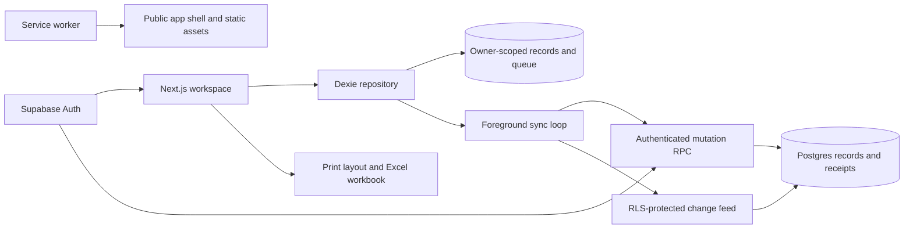

# Architecture

## Structure

| Location | Responsibility |
| --- | --- |
| `src/app` | Next.js layout, metadata, global styles, and static shell entry |
| `src/features` | Workspace, overview, checklists, inspections, findings, and reports |
| `src/lib/domain.ts` | Runtime schemas, question types, scoring, and reporting helpers |
| `src/lib/local.ts` | Dexie records, atomic writes, durable pending operations, and conflict choices |
| `src/lib/sync.ts` | Cloud transport, ordered mutation delivery, and cursor-based pull |
| `supabase/migrations` | Owner scope, data constraints, mutation receipts, and evidence bucket isolation |
| `scripts/worker.js` | Production navigation fallback and build-versioned static cache |

## Ownership and storage

The app uses Supabase email/password authentication. Authenticated users read only `auditflow_records` rows owned by `auth.uid()`. The mutation RPC verifies the session owner again and validates the domain payload, same-owner parent links, optimistic version, and lifecycle. Anonymous users have no table or RPC access. Browser tables key records by account and UUID. The synthetic demo uses its own local namespace and transport is disabled for it.

Record kinds are `template`, `snapshot`, `audit`, `answer`, `finding`, and `capa`. The JSON payloads carry typed feature data, while owner, UUID, lifecycle version, pull revision, deletion, and server timestamps are relational columns. Partial indexes protect question/inspection uniqueness, version numbering, and the single-action constraint. Completed inspections accept only an explicit transition to reopen or archive. Findings and corrective actions remain editable independently. The snapshot UUID is fixed throughout the audit, even when a new publication receives a different display version number on sync.

## Sync and completion

1. A local feature write commits the record and queue item in the same IndexedDB transaction. Each operation has an idempotency UUID and the last known server version. Unattempted consecutive edits can coalesce without changing lifecycle history.
2. When the app is open and online, it sends pending operations in order with the authenticated session. Web Locks serialize device-local pushes where available. Postgres serializes mutations per owner, issues a monotonic revision, and returns a receipt when a previously applied operation is retried.
3. A cursor-based pull applies remote rows and tombstones in revision order. A pending local edit is retained through reconciliation. Responses for different questions use distinct deterministic record IDs.
4. Overlapping edits preserve the local and server variants and pause dependent pushes. Resolve in **Settings → Offline & sync**. When a remote lifecycle locks an answer or invalidates a completion, the server reports the reason and preserves the local variant for export. Failed network requests retry with bounded exponential backoff.
5. Completion checks required responses atomically on-device and again on the server. For snapshots with `assessment: 'conformity'`, it also checks that every item has an outcome and a note for a failure or exception. Offline or unacknowledged completions display **Completion pending**. Each reopen, completion, or archive appends a status event.

The service worker installs only on secure origins after a production build. It precaches the generic shell, local fonts, icons, and bundle chunks. Audit content, authentication traffic, cloud API payloads, and generated downloads are outside that cache. IndexedDB holds the actual offline records. Sync runs in the foreground after reconnecting or reopening the app.

## Extension points

- Evidence can add local attachment metadata and blobs, then use the private bucket path `<owner>/<inspection>/<file>` after parent synchronization.
- Reports already assemble a structured view of the checklist version, responses, findings, and corrective actions. A later report configuration can control block visibility and save immutable exported artifacts.
- Findings and CAPA have independent records and status histories. Expand the finding-to-action relationship to support multiple action rows when needed.
- The optional AI gateway validates the Supabase session and passes a bounded request to an allowlisted endpoint. The local demo calls an OpenAI-compatible API from the browser over HTTPS or loopback when the endpoint allows CORS. River uses a same-origin relay restricted to the loopback server. Each path validates the response and opens proposals in standard editors. File import extracts text in the browser and sends the reviewed text after explicit consent.
